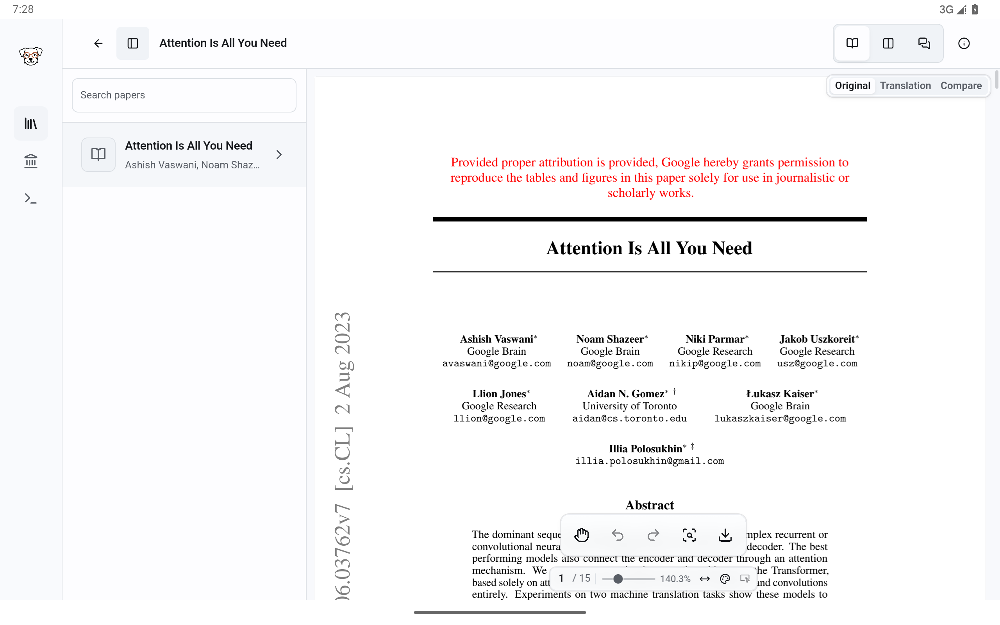
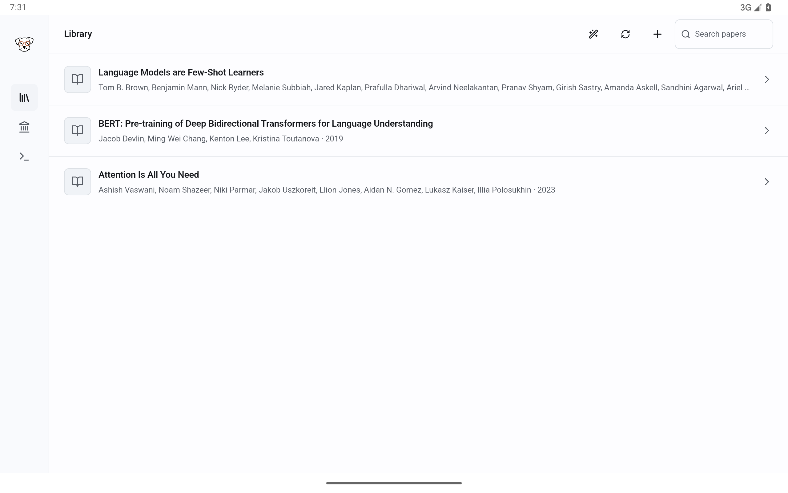

<p align="center">
  
</p>

<h3 align="center">Read papers on a tablet, mark them up, and work through the literature with an agent</h3>

<p align="center">
  Papers, notes, annotations, and handwriting stay on the device. While reading a PDF you can hand the selected passage, a figure, or a note to a remote agent.
</p>

<p align="center">
  <a href="README.md">中文</a> | <b>English</b>
</p>

<p align="center">
  <a href="https://github.com/Tippye/Agentero-mobile/releases"></a>
  <a href="https://github.com/Tippye/Agentero-mobile/blob/main/LICENSE"></a>
  <a href="https://github.com/poco-ai/Agentero"></a>
</p>

---

## What this is

The mobile branch of Agentero, built for Android tablets and foldables (iPad support is still being adapted). It keeps the same reading workflow as the desktop app, but the reader, handwriting layer, and agent panel are rebuilt for touch, a stylus, and offline use.

This is not a cut-down desktop build. The library is still a plain folder: PDFs, Markdown notes, and annotations are ordinary files in the vault, so another device can pick up where you left off after a sync. What differs is the read / compare / discuss presets, the ink layer, and the remote agent.

> Desktop (macOS / Windows / Linux) development and releases live in [poco-ai/Agentero](https://github.com/poco-ai/Agentero); this repository maintains the mobile app only.

---

## Core features

### 1. A reader and annotation layer built for tablets

- **Three reading presets**: original, compare (source and translation side by side), and discuss (paper plus notes). Narrow layouts tuck the side panel into a drawer; wide layouts keep a draggable column and remember each side's width separately.
- **Handwriting**: pen, highlighter, stroke eraser, lasso move/copy/delete, undo, and redo. Holding the pen still for 500 ms snaps the stroke into a line, arrow, rectangle, triangle, or ellipse, and lifting commits it.
- **Two ways to ask**: long-press for one second to select a word or sentence and annotate it from the toolbar, or switch to region select and circle an area of the PDF with no ink to send it to the agent together with a screenshot.

### 2. Translation and layout analysis

- **Translation and compare at any time**: translate a page or the whole paper; show the translation over the source or side by side. Translation and layout analysis run as background tasks that keep going when you leave the paper.
- **Look at the finished PDF first**: when the layout is not ready but a translated PDF matches the current language and service, it opens read-only right away while analysis and gap filling continue in the background.
- **Translation cache switch** (Settings → Translate): on by default, the translation sidecar and finished PDFs sync with the vault; turn it off to keep them on this device. Layout analysis always syncs because figures, citations, and on-demand downloads rely on it.
- **Typesetting works offline**: the fallback font ships in the installer, so translated PDFs still build without network or a mirror.

### 3. A local-first library that syncs

- **Files are the data**: papers, Markdown notes, and annotations live under the app-private `Vault`; structured metadata lives in `.agentero/catalog.sqlite`.
- **Three sync backends**: S3-compatible storage, WebDAV, and Git. WebDAV servers without strong ETags can opt into degraded sync, and up to three read-only mirrors can be published; changes made on a mirror never travel back.
- **Conflicts are reviewed, not merged**: when two devices edit the same file, the pass pauses and you choose per file to keep local, keep remote, or keep both.

<p align="center">
  
  <br/>
  <sub>Card view with first-page previews, folder management, and swipe actions to pin or delete.</sub>
</p>

### 4. A remote agent reading alongside you

- **Browser sign-in**: dsh-remote connections authorize through the browser instead of storing a password in the app.
- **The desktop agent panel, on mobile**: conversation history, model selection, reasoning and tool activity, structured questions, and approvals all work on mobile; host presence is resolved from the server and an offline host is reported clearly.
- **Ask with evidence**: tapping a citation in the translation jumps back to the matching paper location, and sending a question uploads the current PDF page to the remote session.

---

## Screenshots

<details>
<summary><b>Expand for tablet screenshots (library, reader)</b></summary>
<br/>

#### Library

<p align="center">
  
</p>

#### Reader

<p align="center">
  
  <br/>
  <sub>The top bar switches original, translation, and compare; the floating bar holds the pen, undo, lasso, export, and zoom.</sub>
</p>

</details>

---

## Download and install

### Android (recommended)

Download `Agentero-<version>-arm64.apk` from [Releases](https://github.com/Tippye/Agentero-mobile/releases):

- ARM64 tablets, foldables, and phones; Android 13 (API 33) or newer.
- The APK uses the unified release signature, so it upgrades earlier versions in place.
- The first launch creates the vault in app-private storage and needs no storage permission.

### iOS

The iOS project ships in `src-tauri/ios-project.yml`. TestFlight publishing is still frozen, so build and sign it yourself with Xcode.

---

## Build from source

You need Node.js 22+, pnpm, Rust (with the `aarch64-linux-android` target), JDK 17+, and the Android SDK / NDK.

```bash
pnpm install

# frontend + desktop shell
pnpm tauri dev

# Android: signing lives in src-tauri/gen/android/app/release-signing.properties
pnpm tauri android build --apk --target aarch64
```

Artifacts land in `src-tauri/gen/android/app/build/outputs/apk/`. The committed release keystore is shared by CI and local builds, so every release must keep `versionCode` increasing.

The release procedure, bilingual notes, and validation scripts are documented in the [release skill](.agents/skills/release/SKILL.md) and the [bump skill](.agents/skills/bump/SKILL.md).

---

## Credits and license

- The mobile app builds on the shared layer of [poco-ai/Agentero](https://github.com/poco-ai/Agentero); the desktop library, translation, and agent protocol come from upstream.
- Thanks to members of [LinuxDo](https://linux.do/) and [ModelScope](https://modelscope.cn/) for their feedback during early testing.

Released under the [MIT License](LICENSE). Third-party components and licenses are listed in [.github/THIRD_PARTY_NOTICES.md](.github/THIRD_PARTY_NOTICES.md).

