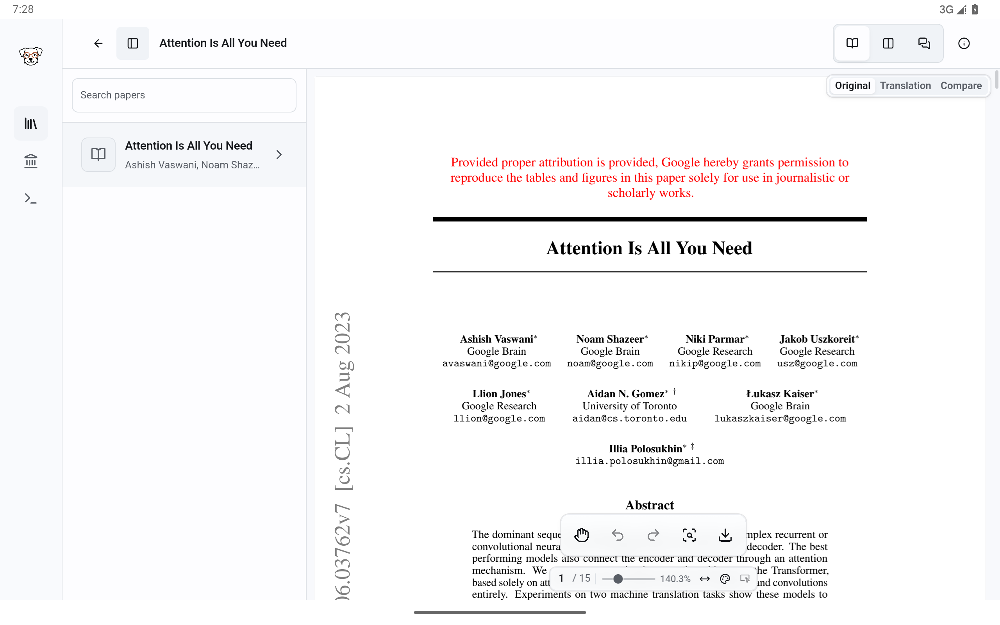
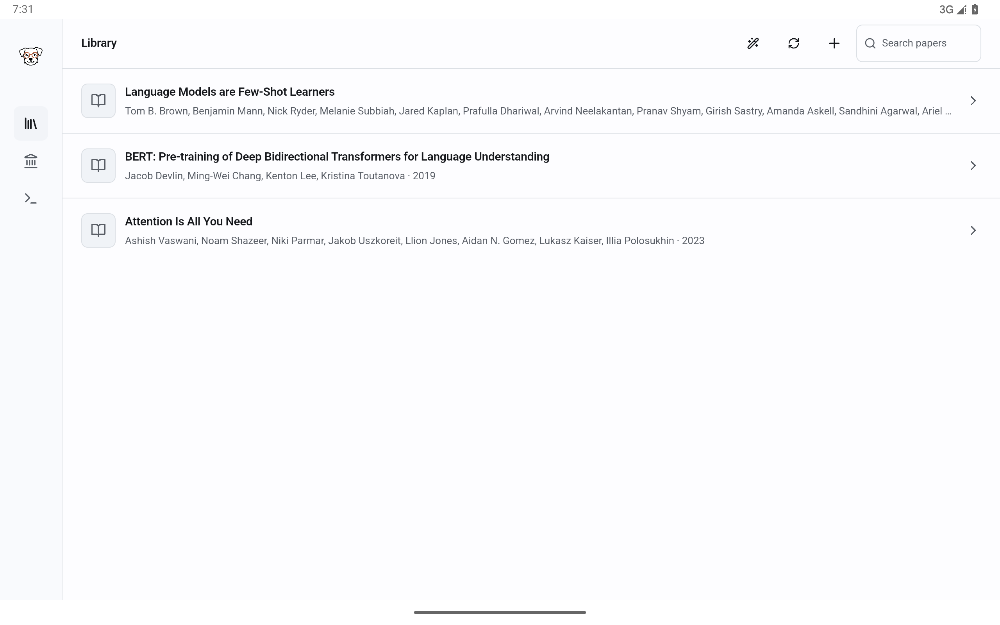

<p align="center">
  
</p>

<h3 align="center">在平板上读论文、写批注，和 Agent 一起把文献读透</h3>

<p align="center">
  论文、笔记、批注和手写笔迹都保存在设备本地；读 PDF 时可以把选中的原文、图表或批注交给远程 Agent 一起分析。
</p>

<p align="center">
  <b>中文</b> | <a href="README.en.md">English</a>
</p>

<p align="center">
  <a href="https://github.com/Tippye/Agentero-mobile/releases"></a>
  <a href="https://github.com/Tippye/Agentero-mobile/blob/main/LICENSE"></a>
  <a href="https://github.com/poco-ai/Agentero"></a>
</p>

---

## 这是什么

Agentero 的移动端分支：面向 Android 平板与折叠屏（iOS 平板在适配中）。它和桌面上读论文的流程保持一致，但按平板的握持、手写笔和离线场景重做了交互。

这里不是桌面的简化版。论文库仍然是本地文件夹，PDF、笔记和批注是同目录下的普通文件，同步到另一台设备后可以接着读；区别在于阅读页的原文 / 对照 / 研讨切换、手写层和远程 Agent 都为触屏重写过。

> 桌面版（macOS / Windows / Linux）的开发与发布在 [poco-ai/Agentero](https://github.com/poco-ai/Agentero)，本仓库只维护移动端。

---

## 核心功能

### 1. 为平板重写的阅读与批注

- **三种阅读预设**：原文、对照（原文 + 译文两栏）和研讨（正文 + 笔记）。窄屏自动收进抽屉，宽屏保留可拖动的侧栏，折叠和展开的比例分别记住。
- **手写批注**：支持笔、荧光笔、按笔擦除、套索移动/复制/删除，以及撤销和重做。笔停 500 ms 会把笔迹吸附成直线、箭头、矩形、三角形或圆/椭圆，抬笔即提交。
- **两种提问方式**：长按 1 秒选中一个词或一句话，用工具栏批注；或者切到区域框选，在 PDF 上圈一块没有笔迹的区域，连同截图一起发给 Agent。

### 2. 翻译与版面解析

- **译文、对照随时切换**：整篇或单页翻译，译文覆盖在原文上，也可以并排看。翻译和版面解析都在后台任务里跑，离开当前论文不会中断。
- **成品 PDF 先看**：版面还没解析完、但已经有匹配当前语言和服务的译文 PDF 时，会先只读显示成品，解析和补块在后台继续。
- **翻译缓存开关**（设置 → 翻译）：默认开启，译文 sidecar 与译文 PDF 随知识库同步；关闭后只留在本机。版面解析结果始终同步，图表、引用和按需下载都依赖它。
- **离线也能排版**：排版保底字体打进安装包，没有网络或镜像不可用时仍然能生成译文 PDF。

### 3. 本地优先的知识库与同步

- **文件就是数据**：论文、笔记（Markdown）和批注保存在应用私有目录的 `Vault` 下，结构化元数据在 `.agentero/catalog.sqlite`。
- **三种同步后端**：S3 兼容对象存储、WebDAV、Git。WebDAV 服务器缺少强 ETag 时可以开启降级同步；还可以加最多三个只读镜像，镜像端的改动不会回传。
- **冲突不自动合并**：两台设备改了同一个文件时先暂停本轮同步，逐文件选择保留本地、保留云端或两份都留。

<p align="center">
  
  <br/>
  <sub>论文库列表：标题、作者与年份直接来自元数据，可切换卡片视图、按文件夹管理，左滑固定离线或删除。</sub>
</p>

### 4. 远程 Agent 伴读

- **第三方浏览器登录**：dsh-remote 连接改用浏览器完成授权，不再在应用里存密码。
- **复用桌面 Agent 面板**：会话历史、模型选择、推理与工具活动、结构化提问和审批都在移动端可用；主机在线状态从服务端解析，离线时会明确提示。
- **带证据提问**：从译文里点引文可以跳回对应论文位置；发送问题时会把当前页 PDF 一起上传到远程会话。

---

## 界面预览

<details>
<summary><b>点击展开：平板截图（文献库、阅读器）</b></summary>
<br/>

#### 文献库

<p align="center">
  
</p>

#### 阅读器

<p align="center">
  
  <br/>
  <sub>顶栏切换原文 / 译文 / 对照；底部浮层提供笔、撤销、套索、导出与缩放。</sub>
</p>

</details>

---

## 下载与安装

### Android（推荐）

在 [Releases](https://github.com/Tippye/Agentero-mobile/releases) 下载 `Agentero-<版本>-arm64.apk`：

- 适用于 ARM64 平板、折叠屏和手机，最低 Android 13（API 33）。
- 安装包使用统一的 release 签名，可以直接覆盖升级旧版本。
- 首次启动会在应用私有目录创建知识库，不需要存储权限。

### iOS

iOS 工程已包含在 `src-tauri/ios-project.yml`，TestFlight 自动发布仍处于冻结状态，需要自行用 Xcode 签名构建。

---

## 从源码构建

需要 Node.js 22+、pnpm、Rust（含 `aarch64-linux-android` target）、JDK 17+ 和 Android SDK / NDK。

```bash
pnpm install

# 前端 + 桌面壳
pnpm tauri dev

# Android：签名配置在 src-tauri/gen/android/app/release-signing.properties
pnpm tauri android build --apk --target aarch64
```

产物在 `src-tauri/gen/android/app/build/outputs/apk/` 下。仓库内的 release keystore 与 CI、本地构建共用同一把钥匙，因此任何一次发布都必须保持 `versionCode` 递增。

发版流程、双语文案与校验脚本见 [release skill](.agents/skills/release/SKILL.md) 和 [bump skill](.agents/skills/bump/SKILL.md)。

---

## 致谢与许可

- 移动端基于 [poco-ai/Agentero](https://github.com/poco-ai/Agentero) 的共享层开发，桌面端的论文库、翻译与 Agent 协议都来自上游。
- 感谢 [LinuxDo](https://linux.do/) 与 [ModelScope 魔搭社区](https://modelscope.cn/) 成员在早期测试中的建议与反馈。

本项目基于 [MIT License](LICENSE) 协议开源。第三方组件与许可证清单见 [.github/THIRD_PARTY_NOTICES.md](.github/THIRD_PARTY_NOTICES.md)。

