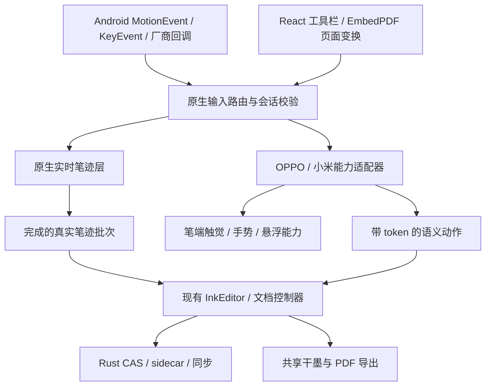

# Agentero Android 手写笔适配方案：OPPO 优先，小米其次

> 设计稿，未实施。更新：2026-11-14。面向论文阅读、PDF 批注、公式与页边手写，以及带来源的笔记整理。
> 第一优先级是 OPPO Pad 与兼容的 OPPO Pencil 2 Pro 等具备笔端触觉硬件的组合；第二优先级是 Xiaomi Pad 与官方兼容触控笔。具体 SKU、地区 ROM、ColorOS/HyperOS、笔固件须在立项时登记，不能用“OPPO Pad / 小米 Pad”代表全部硬件。
> 本方案基于仓库现状和本次重新核实的官方资料；未做上述设备的真机测试。文中的性能数字是拟定验收目标，不是实测结果。

## 1. 决策与交付边界

**采用共享的 Android 原生书写层，叠加 OPPO 与小米官方能力适配器；EmbedPDF 继续负责论文页面，Rust 继续负责笔迹保存与同步。**

- 原生层处理笔输入、历史采样、压力、悬停、掌触取消、实时笔迹，以及厂商笔端触觉和快捷动作。每个采样点的显示与震动不经过 JS/Rust 往返。
- React 保留阅读工具栏、文字选区、高亮、批注卡片、翻译、笔记和 Agent 入口；手指导航继续使用现有阅读器行为。
- 完成的真实笔迹复用 page-space ink、UUID、撤销重做、CAS、墓碑和 PDF 副本导出，不另建厂商笔迹数据库。
- **“OPPO 原生增强版”验收必须包含真实笔端书写震动。** 若官方接口权限或硬件条件未满足，只能交付“通用手写版”，不能把平板震动或音效算作已完成。
- 小米在共享底座稳定后接入官方引擎与笔身触控动作，按具体硬件开放能力；不要求它模拟 OPPO 特有触觉。

### 1.1 对上一轮调研的纠正

上一轮“OPPO、小米没有手写笔 SDK”的断言不成立，不能沿用为架构依据：

1. [OPPO 能力介绍](https://open.oppomobile.com/documentation/page/info?id=13305)、[接入指南](https://open.oppomobile.com/documentation/page/info?id=13306)与[接口说明](https://open.oppomobile.com/documentation/page/info?id=13307)已公开确认：第三方 APK 可接入 **Pencil 2 Pro 的持续书写振动和单次功能振动**，有四种书写材质；需要企业开发者申请、包名/证书绑定和授权码鉴权。公开文档可读不等于应用已获得调用授权。
2. [小米手写笔客户端指南](https://dev.mi.com/xiaomihyperos/documentation/detail?pId=1884)公开了预测、一笔成形、文字识别、跨应用取色、侧旋、悬浮预览和笔身触控按键接口。[版本页](https://dev.mi.com/xiaomihyperos/documentation/detail?pId=1886)在本次核查时列出 0.3.2。
3. Chromium 某条输入路径的限制不能推导出“所有 WebView 的侧键绝对不可用”或固定延迟下限。原生层的价值是明确掌握事件与 OEM 接口，具体 WebView 行为仍需版本化探针验证。
4. 笔端震动、平板系统震动、工具切换的一次触觉、持续书写纹理是不同能力，必须分别验证。
5. 标准 PDF Ink 没有逐点压力字段，但压力外观可写入**矢量 `/AP` 外观流**，不必栅格化。Agentero 已有该导出能力。

## 2. 围绕论文阅读设计交互

### 2.1 三种明确模式

| 模式 | 笔的行为 | 手指行为 | 触觉 |
|---|---|---|---|
| 阅读/选文 | 点引用、长按/拖选文字，调用高亮、翻译、复制引用等现有操作 | 单指滚动、双指缩放 | 不持续震动；离散确认仅在有对应笔端能力时启用 |
| 手写批注 | 页边备注、公式、下划线、图表圈注；保留当前工具 | 默认只导航；笔接触期间冻结新视图手势 | OPPO 笔端按当前工具提供书写触感 |
| 套索/区域 | 选中已有笔迹，或框出论文图表区域 | 与现有选区逻辑一致 | 选区完成可短反馈，不产生持续书写纹理 |

进入 PDF 时恢复用户上次模式；首次默认阅读。为习惯“落笔就写”的用户保留自动书写选项，但开启后显式显示笔工具状态，避免阅读时点文献链接变成墨点。

**分清两种荧光笔：**文字高亮操作的是 PDF 文本选区和语义批注；自由手绘荧光笔存为 ink。不得把用户圈出的自由笔迹擅自转换为文字批注。

### 2.2 与科研工作流的连接

- 选中文字 → 现有翻译/解释/高亮/引用菜单。厂商手势打开菜单，不直接发起模型请求。
- 圈出图表 → 复用现有区域裁剪与来源定位；用户确认后加入笔记或发给 Agent。套索轨迹默认不作为永久墨迹。
- 页边公式与推导 → 保存原始笔迹；后续可显式触发 OCR 并由用户确认结果，公式不能因普通文字识别而被覆盖。
- PDF + 笔记分屏 → 一次只激活一个书写目标，携带文档与视图 token；焦点切换时结束原生会话和震动。
- Markdown 笔记编辑器继续接受文字/引用。完整的可手写笔记块属于后续独立功能，第一阶段不把 Markdown 编辑器替换成大画布。
- 扫描论文无文本层时，选文菜单明确转为区域操作；不以屏幕坐标伪造文字范围。

### 2.3 工具默认值

首版保留细笔、自由荧光笔、整笔橡皮、套索。细笔以可读性优先，轻压仍有可见线条；荧光笔默认固定宽度与透明度，避免遮挡正文。橡皮先复用按笔删除，部分擦除需要额外几何与数据契约，不纳入首版。

系统设置优先于 App 自定义：当厂商 SDK 已返回“切换橡皮”“上个工具”“显示调色盘”这样的语义动作时，按语义执行；不把同一物理双击固定解释成别的功能。系统未占用、官方允许自定义的动作才开放配置。

## 3. 品牌能力与机型优先级

### 3.1 适配等级

| 能力 | OPPO 优先目标 | 小米第二目标 | 实现与验收状态 |
|---|---|---|---|
| 连续压感、笔/指分流 | 必做 | 必做 | Android MotionEvent；必须以实机数据验证连续性 |
| 倾斜、悬停 | 硬件报告且事件实际可用时启用 | 标准事件或官方悬浮预览 | 不把固定 0 当有效倾斜；悬停距离与悬停存在分别记录 |
| 低延迟书写 | 必做 | 必做 | 共享原生实时笔迹层，逐设备比较 |
| 笔端持续书写触觉 | **OPPO 原生增强版必做** | 没有确证接口时不承诺 | 通过 OPPO 官方服务验证；一次振动不等于持续纹理 |
| 双击/轻捏/触控动作 | 按具体笔型与 SDK 开放能力 | 优先焦点触控笔 Pro 官方触控接口 | 不由品牌名猜能力，不硬编码未知 vendor keycode |
| 笔身侧旋 | 不作为 OPPO 首版前提 | Pad 8/8 Pro 及后续兼容机型 + 焦点触控笔 Pro，按官方约束 | 首版只作可选预览，不改变持久化笔刷 |
| 一笔成形、OCR | 后续选用 | 可接官方引擎，涉及鉴权 | 用户明确触发，不覆盖原笔迹 |
| 激光笔、远程翻页 | 首版不做 | 首版不做 | 属于演示场景，优先级低于论文书写 |

### 3.2 测试设备

1. **OPPO 主验收组合**：以 **OPPO Pad 3 Pro + Pencil 2 Pro** 作为官方产品与 SDK 文档都有依据的参考基线，并优先替换为用户实际使用、官方兼容的组合。服务介绍列出 ColorOS 14.0+ 平板，实际仍要核对系统/笔固件。普通 Pencil 2 支持实体按键单击，官方表中没有两种振动；Pencil 2 Pro 支持双击和两种振动，未确证轻捏。Pencil 3 Pro 产品页虽介绍轻捏，当前核实的 SDK 表未列其接口，另行确认，不能混用型号能力。
2. **OPPO 降级组合**：一套无笔端触觉或未开放该能力的兼容组合，确认压感书写照常工作，设置项不误报。
3. **小米主验收组合**：Xiaomi Pad 8/8 Pro + 焦点触控笔 Pro，用于验证公开触控、悬浮与侧旋能力；仅在官方兼容关系成立的 SKU 上测试。
4. **小米回归组合**：Pad 6/7 系列配各自官方兼容笔，检验旧笔的压感、按键及 SDK 不支持时的行为。不能假设新笔跨代通用。

具体购机清单以用户现有硬件和官方兼容表收敛；本方案不以未经确认的跨代配对作为开发前提。

## 4. OPPO：笔端书写震动是独立交付项

### 4.1 接入路线与验证顺序

**直接采用 OPPO 手写笔服务；持续书写触觉的 API 可行性已经由官方文档确证。** [接入指南](https://open.oppomobile.com/documentation/page/info?id=13306)给出以下步骤：

1. 企业开发者账号 → 创建 Agentero 应用 → 申请手写笔服务授权码；[FAQ](https://open.oppomobile.com/documentation/page/info?id=13309)要求包名和签名证书 SHA1。分别解决开发调试与正式签名授权；默认授权码有效期为 5 年。
2. 接入 `ipe_sdk` AAR 与 OCS 基础库。文档当前示例为 `com.oplus.ocs:base:1.0.16`，实施时锁定与实际 AAR 兼容的版本、校验依赖来源和再分发条件。私有 Maven 仓库凭据按官方要求申请，通过本地/CI 配置注入，不写进源码。
3. Manifest 配置 `com.oplus.ocs.ipepencil.AUTH_CODE`，按官方要求保留 SDK 的 R8 规则。
4. 使用 `PencilManagerUnit.getPencilManagerClient(applicationContext)` 注册回调和异步鉴权；仅在 `onConnectionSucceed` 后取得 `PencilManager.getInstance()`。
5. 查询 `getSupportFeatures()`、`getPencilConnectState()`、`getVibrationSwitchState()` 和 `isFunctionFeedbackEnable()`，同时检查应用当前书写会话。

[官方接口](https://open.oppomobile.com/documentation/page/info?id=13307)的能力对照：

| 接口/枚举 | 含义 | Agentero 的使用方式 |
|---|---|---|
| `IpeFeature.FEEDBACK_VIBRATION` | 支持持续书写反馈 | 必须存在才启用书写触感 |
| `IpeFeature.FUNCTION_VIBRATION` | 支持单次功能反馈 | 工具实际切换成功后可触发 |
| `setVibrationType(Vibration.PENCIL / BALLPEN / PEN / ERASER)` | 铅笔/圆珠笔/钢笔/橡皮触感 | 选择工具时设置，检查返回值 |
| `startFeedBackVibration()` | 开始使能书写反馈 | 合法笔 DOWN 后调用 |
| `stopFeedBackVibration()` | 停止书写反馈 | UP/CANCEL、失焦及所有退出路径调用 |
| `startVibration(Vibration.FUNCTION_VIBRATION)` | 调用一次振动一次 | 与持续纹理严格分开 |

**当前文档没有开放“每点设置压力、速度、振幅、频率”的触觉接口，也未给出应用强度档位接口。** 首版由系统/笔固件输出所选材质的真实触感，Agentero 负责工具选择与开始/停止。视觉压感由 MotionEvent 独立实现。厂商宣传的力度响应不能被写成 App 已可控制的参数；若要定制压力→振幅曲线，需通过[官方合作渠道](https://open.oppomobile.com/documentation/page/info?id=13310)申请扩展。

剩余接入核查集中在实际 SKU/地区兼容、SDK 版本、线程限制、联网鉴权/离线可用性、服务重连、发布授权与长时间功耗。官方已有笔端接口，因此不把 `InputDevice.getVibratorManager()` 作为首选替代；系统 `Vibrator`、`View.performHapticFeedback()` 和 Web `navigator.vibrate()` 均不用于冒充该能力。

### 4.2 内部能力模型

以下名称是 Agentero 设计契约，**不是 OPPO SDK 的实际 API**：

```text
PenHapticsCapability
  endpoint: pen | tablet | none | unknown
  mode: systemManaged | appManaged | unavailable
  continuousTexture: unknown | supported | unsupported | requiresAuthorization
  discreteFeedback: unknown | supported | unsupported | requiresAuthorization
  materialPresets: 实际返回或正式文档支持的集合
  intensityControl: 能否调整
  provider / sdkVersion / serviceVersion / reason
```

硬件具备、SDK 可调用、已授权、运行时可用、目标会话激活分别记录。没有收到笔事件不等于断连；输入数字化器存在也不等于某支笔已连接。

### 4.3 触觉与书写同步

原生层建立 `Idle → Contact → Writing/Erasing → End/Cancel` 状态机：

- **落笔**：确认 active token、可写页区域、笔类型、授权、`FEEDBACK_VIBRATION` 与系统开关；`setVibrationType` 成功后调用 `startFeedBackVibration()`，检查返回值。
- **移动与停笔**：正常采样真实压力并画墨迹；不在每次 MOVE 重复 start，不向不存在的触觉接口传压力/速度，也不用预测点驱动马达。停笔时的纹理由厂商实现负责，先实测而非自行反复开关。
- **抬笔、取消、失焦、切页/切文档、屏幕关闭、笔断连、SDK 服务断开**：使本地会话立即失效；manager 仍有效时调用 `stopFeedBackVibration()`。若调用失败或服务已断开，标记状态未知，不能声称物理马达已停；重连且无有效笔触时先确认/清理遗留反馈。
- **工具切换**：笔中途切换时先结束/取消当前工具会话并 stop，再应用新工具；下一笔重新选择材质，防止工具和触感错配。

官方特别警告：漏调 stop 会让后续其他场景书写持续振动。因此 stop 必须在原生层执行，不依赖 JS 定时器或保存成功回执。能力释放使用 `PencilManagerUnitClient.release()`，**不调用 `PencilManager.init/release`**；按官方回调处理 `RELEASE_CODE_SERVICE_DISCONNECTED`，确保旧连接的迟到结果不能恢复旧目标。

### 4.4 论文工具与触觉映射

| 工具/动作 | 产品期望 | 接口不足时 |
|---|---|---|
| 细笔/页边手写 | 默认 `BALLPEN`，可选 `PENCIL` 或 `PEN`，真机对比后确定默认材质 | 无持续触觉则明确不可用，视觉压感保持 |
| 自由荧光笔 | 默认不启用持续触觉，或由用户明确选择已有材质 | 官方无独立马克笔预设，不把圆珠笔称作马克笔触感 |
| 整笔橡皮 | `ERASER`，有效擦除会话中启用，结束即 stop | 仅功能反馈可用时不伪造持续纹理 |
| 工具切换/套索完成 | 有功能反馈且系统开关打开时，实际成功后调用单次反馈 | 只更新视觉状态 |
| 阅读、滚动、点击正文 | 无持续纹理 | 保持无持续纹理 |

尊重系统书写反馈和功能反馈两个独立开关，订阅对应状态变化；系统关闭后应用不能强开。首版 App 可再提供关闭及四种材质选择，**不展示没有 API 支持的强度滑条**。已核实接口不含书写声音控制，因此首版也不承诺原厂沙沙声。无笔端触觉时不自动改为平板持续震动。

### 4.5 OPPO 双击与实体单击

按官方声明的 `com.oplus.ipemanager.action.PENCIL_DOUBLE_CLICK` 广播及 `com.oplus.ipemanager.permission.receiver.DOUBLE_CLICK` 权限接收；读取 `Settings.Global["ipe_pencil_double_click"]`：0 无操作、1 当前工具/橡皮、2 最近工具、3 颜色盘。Pencil 2 的实体按键单击也使用此事件，不能因广播叫 double click 就要求用户双按。

在前台可见且持有当前目标 token 时注册，失焦/`onPause` 注销；现代 Android 的动态 receiver 标志按实际 targetSdk 和官方发送方校验。不把厂商广播暴露成任何应用都能触发的公共工具控制入口。广播没有笔尖坐标，不用它定位文字或自动生成选区。

### 4.6 完成判定

“OPPO 震动适配完成”需要在 **Agentero 的 Release 签名 APK** 内证明：实际笔身产生持续书写反馈；随已支持的工具或参数变化；抬笔、切后台及失联可靠停止；长时间使用没有明显功耗和延迟回退。系统笔记 App 能震动、Demo 能震动、或返回成功码，均不足以单独验收。

若只开放离散反馈，记录为“笔端快捷反馈”；持续纹理保持未完成，不能降低该项标准。若接口需合作授权，把授权列为发布依赖，与通用书写底座并行推进。

## 5. 小米：采用已公开的手写笔引擎

以[官方客户端指南](https://dev.mi.com/xiaomihyperos/documentation/detail?pId=1884)为接入依据。文档当前说明：预测、一笔成形、文字识别需要初始化鉴权；其他列出的能力目前无主动执行鉴权步骤，仍须核对服务开通、SDK 再分发与运行条件。

### 5.1 首批集成

| 官方接口 | Agentero 用途 | 生命周期/限制 |
|---|---|---|
| `MiuiTouchFilmUtils` | 切笔/橡皮、上一个工具、调色盘、笔刷设置，允许的上下滑动作 | `onResume` 初始化，`dispatchKeyEvent` 接入，`onPause` 销毁；回调二次校验 active target |
| `MiuiHoverPreview` | 笔刷或橡皮范围预览 | 绑定实际原生书写 View；系统关闭预览时同步关闭 |
| `MiuiStylusPosture` | 可选的侧旋预览 | 从 `dispatchGenericMotionEvent` 接入；官方限制为 Pad 8/8 Pro 及后续兼容机型 + 焦点触控笔 Pro |
| `MiuiStrokeEstimate` | 可选预测，与 AndroidX 预测做真机 A/B | 需要鉴权；只选一个预测器；预测点不存储、不驱动触觉 |

轻捏/双击按 SDK 返回的系统功能处理；不强行指定“轻捏必定打开调色盘”。上下滑若官方允许自定义，默认调当前笔宽或切预设，不在手写中翻页。未识别按键交回正常分发链，不吞音量键、键盘或系统导航。

官方样例把事件传给 SDK 后仍调用 `super.dispatchKeyEvent`。Agentero 必须按实际分发链验证：SDK 消费的动作由单一来源执行，若平台仍需下游分发则保留事件，但屏蔽 JS 重复切工具；不能机械复制示例产生双切换，也不能未经验证吞掉所有 KeyEvent。

### 5.2 后续能力

- `MiuiOneStroke`：用户显式启用“停顿转标准形状”，用于框图、箭头；不默认作用于公式与汉字。
- `MiuiRecognize`：用户框选手写后转换为文本，保留原始墨迹与来源；识别结果经确认才能进笔记正文。
- `MiuiColorPick`：科研批注收益有限，后置。
- 侧旋驱动持久笔刷需要扩展当前模型；第一阶段可做预览或不用，不把旋转数据冒充 tilt。

鉴权配置包含 App ID 及 Debug/Release 签名。SDK 无法鉴权或服务不可用时，通用压力书写保持可用。确认 SDK 是否联网、上传笔迹或记录数据；没有依据前不宣称 OEM 识别完全离线。

[MiHaptic](https://dev.mi.com/xiaomihyperos/documentation/detail?pId=1526)介绍的是驱动设备线性马达的触感能力，不能据此承诺焦点触控笔中的书写震动。

## 6. 技术架构与现有系统衔接



### 6.1 复用与新增

| 层 | 复用 | 必要新增 |
|---|---|---|
| React | [InkInputBridge](../../../src/components/viewer/pdf/viewport/ink-input-bridge.tsx)、工具状态、选区/裁剪、viewport/zoom | 书写后端选择、页几何同步、完成笔迹接入、渲染确认 |
| TS facade | [stylus.ts](../../../src/lib/mobile/stylus.ts) 的目标 token 和事件订阅 | 能力详情、原生书写配置、触觉设置的类型化入口 |
| Android | Android 分支现有 `StylusAdapter` 注册表与焦点检查 | 标准原生采样、实时笔迹 View、OPPO/Xiaomi 适配器、按键与悬停分发 |
| Rust | 生成绑定、窗口/token 校验、[ink 保存契约](pdf-ink.md) | 仅增加所需能力/控制/完成笔迹协议；保留现有唯一写入路径 |
| 导出 | 标准 InkList + 压力轮廓矢量 `/AP` | 新增笔刷仅在跨端/导出表现可一致后开放 |

Android OEM 实现放 Android 分支；共享协议与 PDF 控制器改动先进入共享 mobile 部分，保持 iOS/桌面 stub 的兼容。不要在共享分支放死绑定 OPPO 的调用，也不要把生成的 Android Activity 当唯一手工补丁位置：通过现有插件生命周期及受控 Activity 接入点实现，验证重新生成工程后仍有效。

### 6.2 热路径与事件唯一所有者

- 原生 View 接收真实点及 historical points，同线程/短队列驱动实时笔迹与 OEM 触觉。
- JS/Rust 接收工具变化、能力变化和完成笔迹批次。传输分块带序号并按同一 stroke UUID 重组，分块不等于绕过现有每笔 20,000 点、每页 100,000 点等存储限制。首版在上限前明确结束该笔并提示，后续才评估误差有界的降采样或版本升级；不静默截断、不用同 UUID 的分块互相覆盖。
- 一次笔触只属于一个输入后端：`web` 或 `native`。不能原生画一笔、JS 又收到同一笔再保存一次。
- 一次手势流从 DOWN 到 UP/CANCEL 的目标保持固定。不能在 WebView 已开始接收流后随意把中途 MOVE 交给原生；需要原生接管时应有显式取消和状态转换。
- 笔端动作来源优先级由能力决定：厂商已识别的同一动作不再由标准 KeyEvent/Web 处理重复执行。按会话、事件身份和动作阶段去重，不能仅用粗暴延时吞掉合法快速操作。
- 取消某个 touch 指针不应误删正在正常书写的 pen 笔迹；仅对取消的流执行对应回滚。

### 6.3 原生渲染选择

优先评估 AndroidX Ink 的 `InProgressStrokesView`。它已封装实时书写和平台低延迟支持，不能当作“先普通 View，性能不够再补低延迟”的空壳。若与现有笔刷或 Tauri 视图层级不兼容，再评估 `androidx.graphics` 的低延迟渲染接口，不预先同时维护两套引擎。

首轮原型必须验证：透明覆盖、裁剪、圆角、分屏、软键盘、工具栏与浮层 Z-order。独立 Surface 的合成有特殊约束；PDF 批注弹窗出现时，应暂停/隐藏覆盖层或保证正确合成顺序。仅当前可写 PDF 视口挂载覆盖层，不盖住整屏 React 界面。

**湿墨/干墨外观是一项门槛。** 现有 [geometry.ts](../../../src/lib/pdf/ink/geometry.ts) 用 perfect-freehand 生成轮廓。Ink 的默认笔刷不会自然一致：先用固定测试轨迹调参并比较笔宽、端点、拐角、透明度；若无法达到阈值，应统一渲染契约或选择与现有轮廓一致的原生实现，不能用“多保留几帧”掩盖笔形跳变。

抬笔后原生保留待交接笔迹，等前端确认新干墨已可呈现再移除。半透明荧光笔必须避免两层重叠加深，交接按 stroke ID 控制显示。`rendered` 与 `persisted` 是两个不同确认：显示了不等于磁盘保存成功；保存失败继续保留草稿、dirty 状态和重试入口。

### 6.4 坐标与笔迹数据

沿用未旋转 CropBox 的 PDF 点坐标；原生像素、屏幕密度、Web CSS 像素、PDF 点之间使用显式矩阵。DOWN 时取得带 `layoutRevision` 的 page → native 变换快照；缩放、滚动、旋转、分屏、键盘或窗口布局改变使该快照失效，取消当前未完成笔迹并停止触觉。

跨页面边界的笔迹首版裁剪于起始页，不把邻页坐标夹成一条页边直线。倾斜的方向也按页面旋转转换，不只转换位置。

持久化只写真实采样点：x/y、归一化 pressure 或 null、笔内时间、可用时的成对 tilt。原始量程、设备信息和采样统计放诊断记录；预测点、触觉波形及设备专属动作不写进论文笔迹文件。硬件 ID 不作为跨重启稳定缓存键。

## 7. 压感、防误触与能力探测

### 7.1 压感

- 按实际事件 source 查询 `getMotionRange(AXIS_PRESSURE, source)`；若设备 source 表示方式不同，核对其范围记录，不能硬编码一个 source 后直接认定无压感。
- 有有效量程时归一化到 `[0,1]`；零压力是有效值，缺失是 `null`。范围声明与实际连续性分别记录。
- 校验轻压、常压、重压的分布、低压起笔、极值与丢点；不按“4096/16384 级”决定质量，也不因一次短采样恒值就永久禁用压感。
- 首版使用现有可跨端复现的笔刷响应：笔使用压力，荧光笔固定宽。设备校准不随每笔观察到的 min/max 自动跳变。
- 若后续增加用户压力曲线/笔刷版本，必须定义其持久化语义与跨端渲染。不能只改 Android 湿墨而让旧笔迹、桌面与导出继续使用不同曲线。

### 7.2 掌触与导航

笔/指使用逐指针 toolType 分类。笔接触期间冻结新的平移、缩放、长按与工具栏误触；抬笔后恢复采用可调短尾随窗，初始试验值 150ms，并以真实手掌测试调整。无悬停时不能依赖“笔进入感应区”触发保护。

已被忽略的手指流不从中途 MOVE 突然恢复为导航，应等它抬起后从新的 DOWN 开始。保留显式“仅笔书写”和“临时禁用触摸导航”，兼容手掌先落屏。面积阈值只作设备校准后的辅助，不使用全品牌统一的硬阈值。

不承诺边写边双指缩放；默认笔抬起后再导航。旋转/缩放途中收到笔 DOWN 时，先确定布局稳定再开始，不用旧页面矩阵出墨。

### 7.3 能力状态

能力至少区分 `unknown / supported / unsupported / requiresAuthorization / temporarilyUnavailable`，并带证据来源、SDK/服务版本和原因。品牌用于选择可能的适配器，真正启用由 SDK 查询、事件观察、授权和真机配置共同决定。

压力、倾斜、悬停、侧键、双击、轻捏、持续笔端触觉、离散笔端触觉分别声明。缓存按应用/SDK、系统构建、输入设备描述与可得的笔固件信息失效；瞬态 `InputDevice.id` 只作当前运行会话索引。

## 8. 分阶段实施与发布门槛

以下是工作量估算，按熟悉 Tauri Android 的开发者估计，不包含厂商审核、等待设备及发布排期；阶段存在并行项，不能机械相加为承诺日期。

| 阶段 | 工作内容 | 出口条件 | 估算 |
|---|---|---|---|
| G0 OPPO 接入验证 | 登记实际机笔组合；按公开指南申请签名授权和 SDK；在 Agentero APK 下验证四种触觉、动作与原生 View | 真实笔端连续触觉成立；若尚未获授权，明确记录为外部依赖未完成，不能以平板震动通过 | 2–4 人日 + 外部等待 |
| G1 共享原生底座 | 输入路由、压力与历史点、页面矩阵、实时笔迹、取消、现有存储交接 | 压感、掌拒、坐标、保存与导出闭环；无重复笔迹 | 5–8 人日 |
| G2 OPPO 增强版 | 官方触觉生命周期、支持的工具材质、快捷动作、设置与异常恢复 | OPPO Release APK 通过连续书写和全取消路径；未完成触觉不得宣称增强版完成 | 3–5 人日，依赖 G0 |
| G3 小米 | 官方 SDK、鉴权、触控动作、悬浮；预测器 A/B | 新旧兼容机型均可用，系统偏好生效，动作不重复 | 3–5 人日 |
| G4 发布回归 | 长论文、分屏、旋转、断连、后台、离线、同步冲突、功耗 | 下表验收通过；已知例外明确列出 | 3–5 人日 |

G0 与 G1 可并行，但 **G0 先于大规模笔刷引擎改造的决策**。OPPO 接口未获授权时，共享底座和小米仍可开发；外部依赖未解决不意味着用户要求的 OPPO 触觉已完成。

## 9. 真机验收矩阵

| 项目 | 方法 | 初始门槛 |
|---|---|---|
| 笔端触觉身份 | 在 Agentero 内与系统笔记同机比较，分别观察笔端与机身；记录系统开关 | 确认笔中马达工作，不能只看 API 返回值 |
| 触觉生命周期 | 抬笔、取消、切工具、切页、失焦、锁屏、断连各重复 30 次；另测接触中停笔 | 退出事件立即请求停止，没有残留持续震动；接触中停笔行为按原厂实现记录，物理停止延迟单独测量 |
| 工具反馈 | 细笔/荧光笔/橡皮、压力阶梯与不同速度 | 仅对官方支持的差异验收；系统自动管理时记录其行为 |
| 压感与细字 | 同一设备画 30 组轻→重线、3–5mm 字与公式上下标 | 轻压可见、无异常断笔，线宽随压力可解释，无恒值假压感 |
| 端到端延迟 | 240fps 或更高帧率相机拍笔尖与首个可见墨迹，报告样本量/刷新率/测量误差 | 原生版以 p95 ≤35ms 为首轮目标，并与同机系统笔记及现有 Web 版比较；不达标需分析后定版 |
| 热路径耗时 | 原生 trace 分别测输入、渲染提交、触觉调用 | 不因 Binder/SDK 调用阻塞下一帧；不以 JS rAF 耗时冒充端到端延迟 |
| 交接外观 | 细笔/透明荧光笔录屏逐帧比较抬笔前后 | 无明显闪烁、重影、加深或笔形跳变 |
| 坐标 | CropBox、0/90/180/270°、多倍缩放、分屏、跨页 | 同一基准点偏差目标 ≤1 PDF pt；变换中旧笔迹取消，不跨页误存 |
| 掌触 | 手掌先落、后落、握笔移动与工具栏边缘测试 | 连续 10 分钟无误出墨/误翻页/误触菜单；记录失败次数，不能用单次成功通过 |
| 快捷动作 | 系统改双击/轻捏功能后重复执行，混合普通键盘输入 | 语义跟随系统；每次合法操作仅执行一次；无关按键不被吞 |
| 数据可靠性 | 保存失败、CAS 冲突、切文档、重试、撤销/重做、同步后重开 | 无重复/丢笔；草稿可恢复；取消笔迹不落盘 |
| PDF 导出 | 桌面与另一 PDF 阅读器查看副本 | 原始页与批注位置正确；压力外观由矢量 `/AP` 保留；不要求其他阅读器恢复原始压力编辑 |
| 功耗与热 | 同机、同亮度/刷新率/工具分别做 30 分钟触觉开关 A/B，至少 3 轮 | 报告增量、温度、掉帧与笔电量；产品阈值据 G0 实测制定，不捏造通用电耗指标 |
| 发布条件 | Release 签名、R8、离线启动、服务不可用/升级 | 核心书写不受 OEM 鉴权失败影响；增强能力状态准确、可恢复 |

所有阈值在 G0 后用真实设备基线评审，保留前后对比。远程真机可验证 APK 和回调，不能替代手持笔触觉、掌触与高速摄影测试。

## 10. 下一步可直接执行的任务

1. 固定主验收设备与笔的完整型号、系统/固件；为该组合建立本地诊断记录。
2. 从 OPPO 手写笔服务获取正式接入条件与样例，在 Agentero 包名和签名下做“压感采样 + 笔端纹理 + 停止控制”最小闭环。
3. 在现有 Tauri Android 宿主上验证原生 View 与 PDF 页面叠层；先测坐标与取消，再选定笔迹渲染器。
4. 扩展共享 Rust 生成协议和 Android 适配器生命周期；完成 JS/native 输入互斥、渲染确认与原有保存队列集成。
5. 完成 OPPO 增强验收后接小米官方 SDK；优先系统工具动作与悬浮，OCR/成形后置。

本稿只制定方案，未集成 SDK、申请厂商服务、联系第三方或改动运行时代码。

## 参考与现有实现

- OPPO 官方：[能力与机型表](https://open.oppomobile.com/documentation/page/info?id=13305)、[企业接入与 SDK 配置](https://open.oppomobile.com/documentation/page/info?id=13306)、[方法、广播与生命周期](https://open.oppomobile.com/documentation/page/info?id=13307)、[鉴权 FAQ](https://open.oppomobile.com/documentation/page/info?id=13309)、[合作渠道](https://open.oppomobile.com/documentation/page/info?id=13310)。
- OPPO 硬件：[Pad 3 Pro / Pencil 2 Pro](https://www.oppo.com/th/accessories/oppo-pad-3-pro/)、[普通 Pencil 2](https://shop.oppojapan.com/view/item/000000000092)、[Pad 5 Pro / Pencil 3 Pro](https://www.oppo.com/uk/accessories/oppo-pad-5-pro/)。地区产品页用于确认硬件能力，不替代国行具体组合兼容表。
- OPPO 官方指南所链接的分发物：[ipe_sdk 版本](https://central.sonatype.com/artifact/com.oplus.ocs/ipe_sdk/versions)、[SDK 示例](https://openfs.oppomobile.com/open/oop/202502/26/2b6943d47404c8d547a7a749a3c0cd75.zip)。本次未集成、编译或运行这些分发物。
- [小米手写笔客户端接入指南](https://dev.mi.com/xiaomihyperos/documentation/detail?pId=1884)、[版本信息](https://dev.mi.com/xiaomihyperos/documentation/detail?pId=1886)、[MiHaptic](https://dev.mi.com/xiaomihyperos/documentation/detail?pId=1526)。
- [Android InputDevice](https://developer.android.com/reference/android/view/InputDevice)、[MotionEvent](https://developer.android.com/reference/android/view/MotionEvent)、[高级手写笔功能](https://developer.android.com/develop/ui/views/touch-and-input/stylus-input/advanced-stylus-features)、[AndroidX Ink](https://developer.android.com/jetpack/androidx/releases/ink)。
- Agentero：[移动端手写笔契约](stylus.md)、[PDF 笔迹与原生编辑](pdf-ink.md)、PDF 阅读功能、[平板共享方案](tablet-shared.md)。
